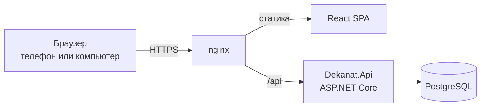

# Архитектура

## Стек

| Часть | Что используем | Почему |
|---|---|---|
| бэкенд | ASP.NET Core на .NET 10 | знаем этот стек, вход, ограничение частоты запросов, health-check и фоновые задачи есть из коробки |
| доступ к данным | EF Core + Npgsql | схема описана в коде, миграции лежат в репозитории |
| база | PostgreSQL 18 | транзакции, индексы, спокойно держит и одного студента, и весь вуз |
| вход | ASP.NET Core Identity, сессия в cookie | хеширование паролей, блокировка после неудачных попыток, cookie с `HttpOnly` недоступна из JavaScript |
| фронт | React, TypeScript, Vite | одно SPA для студента и сотрудника |
| данные на фронте | TanStack Query, openapi-fetch | кеш запросов и типы прямо из контракта API |
| запуск | Docker Compose, nginx | вся система поднимается одной командой, nginx отдаёт статику и проксирует `/api` |

## Как это работает



Фронт и API живут на одном домене. Поэтому CORS не нужен, а cookie сессии уходит только на наш сервер.

## Как разложен код

Дерево папок лежит в [README](../README.md#структура-проекта).

Бэкенд это одно приложение, внутри которого код разложен по разделам кабинета. Всё, что относится к расписанию, лежит в `Features/Schedule`, к заявкам в `Features/Requests` и так далее. Для двух человек и двух недель это проще, чем делить систему на модули, а потом при желании раздел можно вынести целиком.

## Вход и защита данных

Простыми словами это устроено так.

Студент входит по логину и паролю. Пароль в базе не хранится, хранится только его хеш, из которого пароль обратно не получить. После пяти неудачных попыток вход блокируется на несколько минут, а частота запросов на вход ограничена, поэтому перебрать пароль не выйдет.

После входа сервер ставит cookie сессии. Она помечена `HttpOnly`, `Secure` и `SameSite`: JavaScript на странице её не видит, по обычному HTTP она не уходит, а чужой сайт не может отправить с ней запрос.

Каждый запрос сервер связывает со студентом через эту cookie. В адресах студенческих запросов нет id студента. Сервер сам берёт его из сессии и выбирает из базы только данные этого студента. Если подставить в адрес id чужой заявки, сервер ответит 404, так же как на несуществующую заявку. Кабинет сотрудника закрыт ролью: студент туда не попадёт, даже если знает адрес.

Ключи от внешних сервисов, в том числе от ИИ, и пароль базы лежат в переменных окружения на сервере. Во фронт они не попадают, а `.env` не коммитится.

Разделение данных проверяют интеграционные тесты: для каждого раздела там есть случай "студент Б пытается получить данные студента А".

## Контракт API

Черновик всех эндпоинтов с примерами запросов и ответов лежит в [api.md](api.md). По нему фронт делает моки, пока нет бэкенда. Когда появится OpenAPI-документ, главным станет он.

Фронт не описывает запросы руками, а берёт типы из OpenAPI-документа бэкенда:

1. `dotnet build` пишет документ в `backend/openapi/openapi.json`, и он лежит в git. Любое изменение API видно прямо в диффе PR.
2. `npm run api:generate` во `frontend/` превращает документ в типы для клиента `openapi-fetch`.
3. CI падает, если документ или типы не совпадают с кодом.

Договорённости по API:

- студенческие эндпоинты не принимают id студента, он берётся из сессии
- id ресурсов, которые видны в адресе, это UUID
- ошибки приходят в формате ProblemDetails с понятным текстом по-русски
- время в ответах в UTC, фронт показывает его во времени вуза

## Модель данных

### Принципы модели

- `User` хранится в ASP.NET Core Identity. Пароль, блокировка и счётчик неудачных попыток обрабатываются Identity.
- Роли только две: `Student` и `Staff`. Роль `Admin` не используется.
- `StudentProfile` хранит только группу. Факультет, направление и курс получаются через группу.
- `StaffProfile` хранит данные сотрудника деканата и его факультет.
- `Teacher` служит справочником для расписания и не связан с учётной записью.
- `Lesson` содержит текущее состояние пары, а `LessonChange` хранит историю изменений.
- `Request` хранит значения полей в `jsonb`, потому что у разных типов заявок разные наборы полей.
- `Notification` поддерживает типы событий, признак важности и ссылки на связанные объекты.
- Статусы заявок хранятся английскими кодами: `Submitted`, `InProgress`, `Ready`, `Issued`, `Rejected`, `Cancelled`. Русские названия показываются в интерфейсе.

### ER-диаграмма

```mermaid
erDiagram
    %% Персональные данные: User, StudentProfile, StaffProfile, Assessment

    User {
        uuid Id PK
        string UserName UK "Логин"
        string NormalizedUserName UK
        string PasswordHash "Хеш пароля"
        string Role "Student | Staff"
        int AccessFailedCount "Управляет Identity"
        datetime? LockoutEnd "Управляет Identity"
    }

    DataProtectionKey {
        int Id PK
        string FriendlyName
        xml Xml
    }

    StudentProfile {
        uuid Id PK
        uuid UserId FK "1:1 с User"
        string FullName "ФИО, персональные данные"
        uuid GroupId FK
        string GradeBookNumber UK "Номер зачётки, персональные данные"
    }

    StaffProfile {
        uuid Id PK
        uuid UserId FK "1:1 с User"
        string FullName "ФИО, персональные данные"
        uuid FacultyId FK
    }

    Faculty {
        uuid Id PK
        string Name UK
    }

    Program {
        uuid Id PK
        uuid FacultyId FK
        string Name UK
    }

    Group {
        uuid Id PK
        uuid ProgramId FK
        string Name UK
        int Course
    }

    Teacher {
        uuid Id PK
        string FullName "ФИО, персональные данные"
        string Department
        string Position
    }

    Discipline {
        uuid Id PK
        string Name UK
        uuid ProgramId FK
    }

    Lesson {
        uuid Id PK
        datetime StartsAt "Текущее время начала"
        datetime EndsAt "Текущее время окончания"
        string Room "Текущая аудитория"
        string LessonType "Лекция | Практика | Лабораторная | Консультация | Экзамен | Зачёт | Дифзачёт"
        bool IsCancelled "Текущий признак отмены"
        uuid DisciplineId FK
        uuid TeacherId FK
        uuid GroupId FK
    }

    LessonChange {
        uuid Id PK
        uuid LessonId FK
        string ChangeType "Reschedule | RoomChange | Cancellation"
        datetime? OldStartsAt
        datetime? NewStartsAt
        string? OldRoom
        string? NewRoom
        string? Reason
        datetime ChangedAt
        uuid ChangedByUserId FK
    }

    Assessment {
        uuid Id PK
        uuid StudentProfileId FK
        uuid DisciplineId FK
        int Semester
        string ControlForm "Экзамен | Зачёт | Дифзачёт | Курсовая | Другое"
        string Grade "Оценка или зачёт"
        decimal? Score
        date Date
        string Status "Planned | Passed | Failed | Debt | NotAdmitted"
        string? NotAdmittedReason
        date? RetakeDeadline
    }

    RequestType {
        uuid Id PK
        string Name UK
        string Description
        int ProcessingDays "Срок изготовления в рабочих днях"
        jsonb FieldSchema "Описание полей заявки"
    }

    Request {
        uuid Id PK
        uuid StudentProfileId FK
        uuid RequestTypeId FK
        jsonb Fields "Значения полей заявки"
        datetime CreatedAt
        string CurrentStatus "Submitted | InProgress | Ready | Issued | Rejected | Cancelled"
        date? EstimatedReadyDate "Примерная дата готовности"
        string? IssuePlace "Место выдачи"
        datetime? IssueDeadline "Срок выдачи"
        uuid? RelatedAssessmentId FK "Для заявления на пересдачу"
    }

    RequestStatusHistory {
        uuid Id PK
        uuid RequestId FK
        string Status
        string? Comment
        uuid ChangedByUserId FK
        datetime ChangedAt
    }

    Announcement {
        uuid Id PK
        string Title
        string Content
        datetime PublishedAt
        datetime? ExpiresAt "Срок актуальности"
        bool IsImportant "Показывать на Сегодня"
        string AudienceType "All | Faculty | Group"
        uuid? FacultyId FK
        uuid? GroupId FK
        uuid AuthorUserId FK
    }

    Notification {
        uuid Id PK
        uuid UserId FK
        string Type "LessonChange | RequestStatus | Announcement | Deadline"
        string Title
        string Content
        bool IsImportant
        bool IsRead
        datetime CreatedAt
        datetime? ReadAt
        string? DedupKey UK "Защита от повторных уведомлений"
        uuid? LessonId FK
        uuid? RequestId FK
        uuid? AnnouncementId FK
        uuid? AssessmentId FK
    }

    User ||--o| StudentProfile : "имеет профиль студента"
    User ||--o| StaffProfile : "имеет профиль сотрудника"
    Faculty ||--o{ Program : "содержит"
    Program ||--o{ Group : "содержит"
    Group ||--o{ StudentProfile : "включает"
    Faculty ||--o{ StaffProfile : "относится к"
    Program ||--o{ Discipline : "включает"
    Group ||--o{ Lesson : "имеет"
    Teacher ||--o{ Lesson : "ведёт"
    Discipline ||--o{ Lesson : "включает"
    Lesson ||--o{ LessonChange : "имеет историю"
    User ||--o{ LessonChange : "внёс изменение"
    StudentProfile ||--o{ Assessment : "имеет"
    Discipline ||--o{ Assessment : "оценивается"
    StudentProfile ||--o{ Request : "создаёт"
    RequestType ||--o{ Request : "определяет"
    Request ||--o{ RequestStatusHistory : "имеет историю"
    User ||--o{ RequestStatusHistory : "изменил статус"
    Assessment ||--o{ Request : "может иметь заявления"
    User ||--o{ Announcement : "публикует"
    Faculty ||--o{ Announcement : "адресована факультету"
    Group ||--o{ Announcement : "адресована группе"
    User ||--o{ Notification : "получает"
    Lesson ||--o{ Notification : "может породить"
    Request ||--o{ Notification : "может породить"
    Announcement ||--o{ Notification : "может породить"
    Assessment ||--o{ Notification : "может породить"
```

### Персональные данные

| Таблица | Персональные поля | Правило доступа |
|---|---|---|
| `User` | `UserName`, `PasswordHash` | Пароль хранится только как хеш Identity, логин не показывается другим пользователям |
| `StudentProfile` | `FullName`, `GradeBookNumber` | Студент видит только свой профиль, сотрудник деканата видит профили студентов своего факультета |
| `StaffProfile` | `FullName` | Сотрудник видит свой профиль, студенты не видят данные сотрудников |
| `Teacher` | `FullName` | Справочник расписания, в интерфейсе студента показывается имя преподавателя |
| `Assessment` | Связь со студентом, оценки и баллы | Студент видит только свои оценки, сотрудник видит оценки в рамках своих полномочий |

### Как модель поддерживает экраны

| Экран | Что даёт модель |
|---|---|
| "Сегодня" | `Lesson` содержит актуальные время и аудиторию, `LessonChange` хранит историю, `Assessment` содержит долги и сроки, `Request` содержит примерную готовность, `Announcement` содержит признак важности |
| "Расписание" | `Lesson` содержит актуальные время, аудиторию и признак отмены, `LessonChange` объясняет изменение |
| "Учёба" | `Assessment.Status` различает `Debt` и `NotAdmitted`, `NotAdmittedReason` объясняет причину, `RetakeDeadline` показывает срок подачи |
| "Заявки" | `RequestType.ProcessingDays` помогает рассчитать примерную дату готовности, `Request.EstimatedReadyDate`, `IssuePlace` и `IssueDeadline` поддерживают статусы и выдачу |
| "Уведомления" | `Notification.Type`, `IsImportant` и связи с `Lesson`, `Request`, `Announcement`, `Assessment` открывают связанный объект |
| Очередь сотрудника | `Request.CurrentStatus`, `RequestStatusHistory` и `StaffProfile.FacultyId` поддерживают фильтры, историю и разграничение по факультету |
| Перенос пары | `Lesson` меняется транзакционно, `LessonChange` сохраняет прежнее и новое состояние, `Notification` создаётся с ключом защиты от повторов |

### Индексы и ограничения

- Уникальный индекс `User.UserName`.
- Уникальный индекс `StudentProfile.GradeBookNumber`.
- Составной индекс `Lesson (GroupId, StartsAt)` для расписания группы.
- Составной индекс `Lesson (TeacherId, StartsAt)` для расписания преподавателя.
- Составной индекс `Lesson (Room, StartsAt)` для проверки занятости аудитории при переносе пары.
- Индекс `Request (StudentProfileId, CreatedAt DESC)` для списка заявок студента.
- Индекс `Request (CurrentStatus, CreatedAt)` для очереди сотрудника.
- Частичный индекс `Notification (UserId) WHERE IsRead = false` для непрочитанных уведомлений.
- Уникальный индекс `Notification.DedupKey`, если ключ задан.
- Ограничения `CHECK` для `Role`, `LessonType`, `ControlForm`, `Assessment.Status`, `Request.CurrentStatus`, `Announcement.AudienceType`, `Notification.Type` и `LessonChange.ChangeType`.

## Нагрузка

API не хранит состояние в памяти: сессия лежит в cookie, а ключи для её подписи в базе. Поэтому рядом можно поднять несколько копий API за тем же nginx, и пользователи этого не заметят. Под частые запросы вроде расписания на неделю и списка заявок студента в базе будут индексы.
