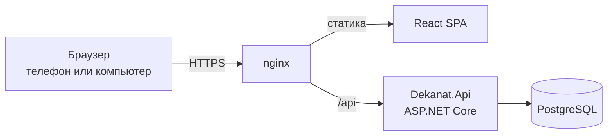

# Архитектура

## Стек

| Часть | Что используем | Почему |
|---|---|---|
| бэкенд | ASP.NET Core на .NET 10 | знаем этот стек, вход, ограничение частоты запросов, health-check и фоновые задачи есть из коробки |
| доступ к данным | EF Core + Npgsql | схема описана в коде, миграции лежат в репозитории |
| база | PostgreSQL 18 | транзакции, индексы, спокойно держит и одного студента, и весь вуз |
| вход | ASP.NET Core Identity, сессия в cookie | хеширование паролей, блокировка после неудачных попыток, cookie с `HttpOnly` недоступна из JavaScript |
| фронт | React, TypeScript, Vite | одно SPA для студента и сотрудника |
| данные на фронте | TanStack Query, openapi-fetch | кеш запросов и типы прямо из контракта API |
| запуск | Docker Compose, nginx | вся система поднимается одной командой, nginx отдаёт статику и проксирует `/api` |

## Как это работает

Фронт и API живут на одном домене. Поэтому CORS не нужен, а cookie сессии уходит только на наш сервер.

## Как разложен код

Дерево папок лежит в [README](../README.md#структура-проекта).

Бэкенд это одно приложение, внутри которого код разложен по разделам кабинета. Всё, что относится к расписанию, лежит в `Features/Schedule`, к заявкам в `Features/Requests` и так далее. Для двух человек и двух недель это проще, чем делить систему на модули, а потом при желании раздел можно вынести целиком.

## Вход и защита данных

Простыми словами это устроено так.

Студент входит по логину и паролю. Пароль в базе не хранится, хранится только его хеш, из которого пароль обратно не получить. После пяти неудачных попыток вход блокируется на несколько минут, а частота запросов на вход ограничена, поэтому перебрать пароль не выйдет.

После входа сервер ставит cookie сессии. Она помечена `HttpOnly`, `Secure` и `SameSite`: JavaScript на странице её не видит, по обычному HTTP она не уходит, а чужой сайт не может отправить с ней запрос.

Каждый запрос сервер связывает со студентом через эту cookie. В адресах студенческих запросов нет id студента. Сервер сам берёт его из сессии и выбирает из базы только данные этого студента. Если подставить в адрес id чужой заявки, сервер ответит 404, так же как на несуществующую заявку. Кабинет сотрудника закрыт ролью: студент туда не попадёт, даже если знает адрес.

Ключи от внешних сервисов, в том числе от ИИ, и пароль базы лежат в переменных окружения на сервере. Во фронт они не попадают, а `.env` не коммитится.

Разделение данных проверяют интеграционные тесты: для каждого раздела там есть случай "студент Б пытается получить данные студента А".

## Контракт API

Фронт не описывает запросы руками, а берёт типы из OpenAPI-документа бэкенда:

1. `dotnet build` пишет документ в `backend/openapi/openapi.json`, и он лежит в git. Любое изменение API видно прямо в диффе PR.
2. `npm run api:generate` во `frontend/` превращает документ в типы для клиента `openapi-fetch`.
3. CI падает, если документ или типы не совпадают с кодом.

Договорённости по API:

- студенческие эндпоинты не принимают id студента, он берётся из сессии
- id ресурсов, которые видны в адресе, это UUID
- ошибки приходят в формате ProblemDetails с понятным текстом по-русски
- время в ответах в UTC, фронт показывает его во времени вуза

## Модель данных

Основные сущности: пользователь и его роль, профиль студента, факультет, направление, группа, преподаватель, дисциплина, пара и её изменения, оценка, тип заявки, заявка и история её статусов, объявление, уведомление. ER-диаграмму добавим сюда, когда согласуем модель.

## Нагрузка

API не хранит состояние в памяти: сессия лежит в cookie, а ключи для её подписи в базе. Поэтому рядом можно поднять несколько копий API за тем же nginx, и пользователи этого не заметят. Под частые запросы вроде расписания на неделю и списка заявок студента в базе будут индексы.
