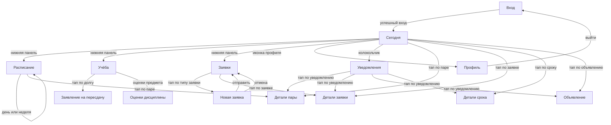
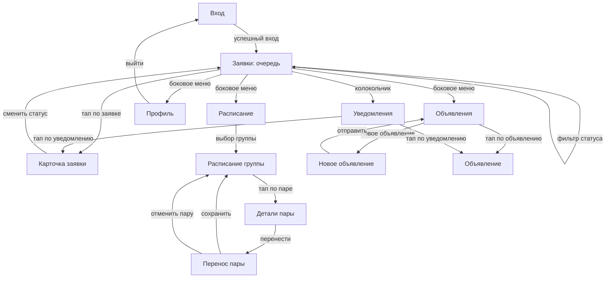

# Экраны и навигация

## Навигация

Кабинет использует одинаковую навигацию для студента и сотрудника. На телефоне основные разделы находятся в нижней панели, а уведомления открываются через колокольчик в шапке. На компьютере все разделы вынесены в боковое меню.

| Устройство | Студент | Сотрудник |
|---|---|---|
| Телефон | "Сегодня", "Расписание", "Учёба", "Заявки", "Профиль" | "Заявки", "Расписание", "Объявления", "Профиль" |
| Компьютер | "Сегодня", "Расписание", "Учёба", "Заявки", "Уведомления", "Профиль" | "Заявки", "Расписание", "Объявления", "Уведомления", "Профиль" |
| Шапка | Колокольчик и аватар | Колокольчик и аватар |

## Переходы студента



## Переходы сотрудника



## Вход

```text
┌──────────────────────────────────────────┐
│              Кабинет студента             │
│             Концепт для конкурса          │
│                                          │
│  Логин                                   │
│  ┌────────────────────────────────────┐  │
│  │ student@example.ru                 │  │
│  └────────────────────────────────────┘  │
│                                          │
│  Пароль                                  │
│  ┌────────────────────────────────────┐  │
│  │ ••••••••                    [👁]    │  │
│  └────────────────────────────────────┘  │
│                                          │
│  [                Войти                 ] │
│                                          │
│  Неверный логин или пароль.              │
│                                          │
│  Вход заблокирован, подождите 5 минут.   │
│                                          │
│  Это демонстрационный сервис,            │
│  данные вымышленные.                     │
└──────────────────────────────────────────┘
```

После входа студент попадает на "Сегодня", сотрудник открывает очередь заявок.

## Сегодня

```text
┌──────────────────────────────────────────┐
│ Сегодня, суббота, 7 ноября   🔔 3   👤    │
├──────────────────────────────────────────┤
│ Следующая пара                           │
│ ┌──────────────────────────────────────┐ │
│ │ 12:20–13:50 · Математический анализ  │ │
│ │ ауд. 305 · Иванов И. И.              │ │
│ │ Перенос: было 10:40, ауд. 214        │ │
│ │                        [Подробнее]   │ │
│ └──────────────────────────────────────┘ │
│                                          │
│ Ближайший срок                           │
│ ┌──────────────────────────────────────┐ │
│ │ Подать на пересдачу по физике        │ │
│ │ до 18 ноября · осталось 11 дней      │ │
│ └──────────────────────────────────────┘ │
│                                          │
│ Важное                                   │
│ ┌──────────────────────────────────────┐ │
│ │ Допуск к сессии                      │ │
│ │ Не сдана лабораторная №3 по физике.  │ │
│ │ [Подать на пересдачу]                │ │
│ └──────────────────────────────────────┘ │
│                                          │
│ Активные заявки                          │
│ ┌──────────────────────────────────────┐ │
│ │ Справка в военкомат · В работе       │ │
│ │ Готовность примерно 12 ноября        │ │
│ └──────────────────────────────────────┘ │
│                                          │
│ Важные объявления                        │
│ ┌──────────────────────────────────────┐ │
│ │ Перенос консультации по физике       │ │
│ │ Сегодня, 16:30 · ауд. 305            │ │
│ └──────────────────────────────────────┘ │
├──────────────────────────────────────────┤
│ Сегодня  Расписание  Учёба  Заявки  Профиль │
└──────────────────────────────────────────┘
```

## Расписание

```text
┌──────────────────────────────────────────┐
│ ← Расписание              🔔 3   👤       │
├──────────────────────────────────────────┤
│ [День] [Неделя]                          │
│ Суббота, 7 ноября                        │
├──────────────────────────────────────────┤
│ 09:00–10:30                              │
│ ┌──────────────────────────────────────┐ │
│ │ История России                       │ │
│ │ ауд. 118 · Петрова А. С.             │ │
│ │ Лекция                               │ │
│ └──────────────────────────────────────┘ │
│                                          │
│ 12:20–13:50                              │
│ ┌──────────────────────────────────────┐ │
│ │ Математический анализ                │ │
│ │ ауд. 305 · Иванов И. И.              │ │
│ │ ~~было 10:40, ауд. 214~~             │ │
│ │ Практика · [Подробнее]               │ │
│ └──────────────────────────────────────┘ │
│                                          │
│ 16:30–18:00                              │
│ ┌──────────────────────────────────────┐ │
│ │ Физика · Консультация                │ │
│ │ ауд. 305 · Смирнов П. В.             │ │
│ └──────────────────────────────────────┘ │
├──────────────────────────────────────────┤
│ Сегодня  Расписание  Учёба  Заявки  Профиль │
└──────────────────────────────────────────┘
```

## Детали пары у студента

```text
┌──────────────────────────────────────────┐
│ ← Математический анализ   🔔 3   👤       │
├──────────────────────────────────────────┤
│ Суббота, 7 ноября                        │
│                                          │
│ Текущее время                            │
│ 12:20–13:50                              │
│ Аудитория: 305                           │
│ Преподаватель: Иванов И. И.              │
│ Тип: Практика                            │
│                                          │
│ Изменение                                │
│ ┌──────────────────────────────────────┐ │
│ │ Перенос                              │ │
│ │ Было: 10:40–12:10, ауд. 214          │ │
│ │ Стало: 12:20–13:50, ауд. 305         │ │
│ │ Изменено: 6 ноября, 18:20            │ │
│ │ Причина: занятость аудитории         │ │
│ └──────────────────────────────────────┘ │
│                                          │
│ [Назад к расписанию]                     │
└──────────────────────────────────────────┘
```

## Учёба

```text
┌──────────────────────────────────────────┐
│ ← Учёба                   🔔 3   👤       │
├──────────────────────────────────────────┤
│ Средний балл: 4.3                        │
│ Сессия: 14–25 января                     │
│                                          │
│ ┌──────────────────────────────────────┐ │
│ │ Допуск к сессии: под угрозой         │ │
│ │ Физика: не сдана лабораторная №3     │ │
│ │ Срок подачи на пересдачу: 18 ноября  │ │
│ │ [Подать на пересдачу]                │ │
│ └──────────────────────────────────────┘ │
│                                          │
│ Оценки за семестр                        │
│ ┌──────────────────────────────────────┐ │
│ │ Математический анализ   5  экзамен   │ │
│ │ История России          Зачёт        │ │
│ │ Физика                  Долг         │ │
│ │ Английский язык         4  дифзачёт  │ │
│ └──────────────────────────────────────┘ │
│                                          │
│ Прошлые семестры                         │
│ [1 семестр] [2 семестр] [3 семестр]      │
├──────────────────────────────────────────┤
│ Сегодня  Расписание  Учёба  Заявки  Профиль │
└──────────────────────────────────────────┘
```

## Оценки дисциплины

```text
┌──────────────────────────────────────────┐
│ ← Физика                  🔔 3   👤       │
├──────────────────────────────────────────┤
│ Семестр: осень 2026                      │
│ Итог по предмету: не получен             │
│ Статус: долг                             │
│                                          │
│ Причина недопуска                        │
│ Не сдана лабораторная №3.                │
│                                          │
│ Срок подачи на пересдачу: 18 ноября      │
│                                          │
│ [Подать на пересдачу]                    │
│                                          │
│ Прошлые попытки                          │
│ ┌──────────────────────────────────────┐ │
│ │ Пересдача от 30 октября · Отклонена  │ │
│ └──────────────────────────────────────┘ │
└──────────────────────────────────────────┘
```

## Заявки

```text
┌──────────────────────────────────────────┐
│ ← Заявки                  🔔 3   👤       │
├──────────────────────────────────────────┤
│ Быстрое оформление                       │
│ ┌──────────────┐ ┌──────────────┐        │
│ │ Справка      │ │ Справка      │        │
│ │ в военкомат  │ │ на руки      │        │
│ └──────────────┘ └──────────────┘        │
│ ┌──────────────┐ ┌──────────────┐        │
│ │ Пересдача    │ │ Другое       │        │
│ └──────────────┘ └──────────────┘        │
│                                          │
│ Мои заявки                               │
│ [Все] [Подана] [В работе] [Готова]       │
│                                          │
│ ┌──────────────────────────────────────┐ │
│ │ Справка в военкомат                  │ │
│ │ В работе · создана 5 ноября          │ │
│ │ Готовность примерно 12 ноября        │ │
│ │ [Открыть]                            │ │
│ └──────────────────────────────────────┘ │
│                                          │
│ ┌──────────────────────────────────────┐ │
│ │ Заявление на пересдачу физики        │ │
│ │ Подана · создана 6 ноября            │ │
│ │ Срок подачи: до 18 ноября            │ │
│ │ [Открыть]                            │ │
│ └──────────────────────────────────────┘ │
├──────────────────────────────────────────┤
│ Сегодня  Расписание  Учёба  Заявки  Профиль │
└──────────────────────────────────────────┘
```

Популярные типы заявок показаны карточками прямо на экране. Путь "Заявки", выбор карточки типа, кнопка "Отправить" занимает три касания от главного экрана.

## Новая заявка

```text
┌──────────────────────────────────────────┐
│ ← Справка в военкомат     🔔 3   👤       │
├──────────────────────────────────────────┤
│ Данные подставлены из профиля            │
│ ФИО: Иванова Настя                       │
│ Группа: ПИ-21                            │
│                                          │
│ Комментарий                              │
│ ┌──────────────────────────────────────┐ │
│ │ Нужна для военкомата                 │ │
│ └──────────────────────────────────────┘ │
│                                          │
│ Примерная готовность: 12 ноября          │
│                                          │
│ [           Отправить          ]         │
│ [             Отмена            ]        │
└──────────────────────────────────────────┘
```

## Заявление на пересдачу

```text
┌──────────────────────────────────────────┐
│ ← Пересдача по физике     🔔 3   👤       │
├──────────────────────────────────────────┤
│ Дисциплина: Физика                       │
│ Причина: не сдана лабораторная №3        │
│                                          │
│ Данные подставлены из профиля            │
│ ФИО: Иванова Настя                       │
│ Группа: ПИ-21                            │
│                                          │
│ Комментарий                              │
│ ┌──────────────────────────────────────┐ │
│ │ Прошу допустить к пересдаче.         │ │
│ └──────────────────────────────────────┘ │
│                                          │
│ Срок подачи: до 18 ноября                │
│                                          │
│ [           Отправить          ]         │
│ [             Отмена            ]        │
└──────────────────────────────────────────┘
```

## Детали заявки

```text
┌──────────────────────────────────────────┐
│ ← Справка в военкомат     🔔 3   👤       │
├──────────────────────────────────────────┤
│ Статус: В работе                         │
│ Создана: 5 ноября, 10:12                 │
│ Примерная готовность: 12 ноября          │
│                                          │
│ Данные заявки                            │
│ ФИО: Иванова Настя                       │
│ Группа: ПИ-21                            │
│ Тип: Справка в военкомат                 │
│ Комментарий: нужна для военкомата        │
│                                          │
│ История                                  │
│ 5 ноября, 10:12 · Подана                 │
│ 5 ноября, 14:30 · В работе               │
│ Комментарий: передана в деканат          │
│                                          │
│ Когда заявка станет готовой, здесь       │
│ появятся место и срок выдачи.            │
└──────────────────────────────────────────┘
```

## Уведомления

```text
┌──────────────────────────────────────────┐
│ ← Уведомления             🔔 3   👤       │
├──────────────────────────────────────────┤
│ [Важные] [Все]                           │
│                                          │
│ ┌──────────────────────────────────────┐ │
│ │ ● Справка готова                     │ │
│ │ Забрать в деканате до 17:00          │ │
│ │ [Открыть заявку]                     │ │
│ └──────────────────────────────────────┘ │
│                                          │
│ ┌──────────────────────────────────────┐ │
│ │ ● Перенос пары                       │ │
│ │ Матанализ: 10:40, ауд. 214           │ │
│ │ стало 12:20, ауд. 305                │ │
│ │ [Открыть пару]                       │ │
│ └──────────────────────────────────────┘ │
│                                          │
│ ┌──────────────────────────────────────┐ │
│ │   Объявление группы                  │ │
│ │ Консультация по физике перенесена    │ │
│ │ [Открыть объявление]                 │ │
│ └──────────────────────────────────────┘ │
├──────────────────────────────────────────┤
│ Сегодня  Расписание  Учёба  Заявки  Профиль │
└──────────────────────────────────────────┘
```

## Профиль

```text
┌──────────────────────────────────────────┐
│ ← Профиль                 🔔 3   👤       │
├──────────────────────────────────────────┤
│ ┌──────────────────────────────────────┐ │
│ │             [Аватар]                 │ │
│ │         Иванова Настя                │ │
│ └──────────────────────────────────────┘ │
│                                          │
│ Факультет: Информатики                   │
│ Направление: Программная инженерия       │
│ Курс: 1                                  │
│ Группа: ПИ-21                            │
│ Номер зачётки: 2026-0123                 │
│                                          │
│ Это концепт для конкурса,                │
│ а не официальный сервис вуза.            │
│                                          │
│ [          Выйти           ]             │
├──────────────────────────────────────────┤
│ Сегодня  Расписание  Учёба  Заявки  Профиль │
└──────────────────────────────────────────┘
```

## Очередь заявок

```text
┌────────────────────────────────────────────────────────┐
│ Деканат · Заявки                    🔔 2   👤           │
├───────────────┬────────────────────────────────────────┤
│ Меню          │ Фильтры: [Подана] [В работе] [Готова]  │
│               │                                        │
│ Заявки        │ ┌────────────────────────────────────┐ │
│ Расписание    │ │ Справка в военкомат                │ │
│ Объявления    │ │ Иванова Настя · ПИ-21              │ │
│ Уведомления   │ │ Подана · 5 ноября, 10:12           │ │
│ Профиль       │ │ [Открыть]                          │ │
│               │ └────────────────────────────────────┘ │
│               │                                        │
│               │ ┌────────────────────────────────────┐ │
│               │ │ Заявление на пересдачу физики      │ │
│               │ │ Марков Марк · ПИ-21                │ │
│               │ │ В работе · 6 ноября, 09:40         │ │
│               │ │ [Открыть]                          │ │
│               │ └────────────────────────────────────┘ │
└────────────────────────────────────────────────────────┘
```
## Детали пары у сотрудника

```text
┌────────────────────────────────────────────────────────┐
│ ← Математический анализ              🔔 2   👤           │
├────────────────────────────────────────────────────────┤
│ Суббота, 7 ноября                                        │
│                                                        │
│ Текущее время                                            │
│ 10:40–12:10                                              │
│ Аудитория: 214                                           │
│ Преподаватель: Иванов И. И.                              │
│ Тип: Практика                                            │
│ Группа: ПИ-21                                            │
│                                                        │
│ [ Перенести ]  [ Отменить пару ]                         │
└────────────────────────────────────────────────────────┘
```

## Карточка заявки сотрудника

```text
┌────────────────────────────────────────────────────────┐
│ ← Справка в военкомат               🔔 2   👤           │
├────────────────────────────────────────────────────────┤
│ Студент: Иванова Настя · ПИ-21                          │
│ Создана: 5 ноября, 10:12                                │
│ Текущий статус: В работе                                │
│                                                        │
│ Данные заявки                                           │
│ Тип: Справка в военкомат                                │
│ Комментарий: нужна для военкомата                       │
│                                                        │
│ История статусов                                        │
│ 5 ноября, 10:12 · Подана                                │
│ 5 ноября, 14:30 · В работе · передана в деканат         │
│                                                        │
│ Следующее действие                                      │
│ [ Отметить "Готова" ]                                   │
│ [ Отклонить ]                                           │
│                                                        │
│ При готовности: место выдачи и срок                     │
│ ┌──────────────────────────────────────┐               │
│ │ Деканат, кабинет 204, до 17:00       │               │
│ └──────────────────────────────────────┘               │
└────────────────────────────────────────────────────────┘
```

## Расписание группы

```text
┌────────────────────────────────────────────────────────┐
│ Деканат · Расписание группы          🔔 2   👤           │
├───────────────┬────────────────────────────────────────┤
│ Меню          │ Группа: ПИ-21                           │
│               │ Суббота, 7 ноября                       │
│ Заявки        │                                        │
│ Расписание    │ 10:40–12:10                             │
│ Объявления    │ ┌────────────────────────────────────┐ │
│ Уведомления   │ │ Математический анализ              │ │
│ Профиль       │ │ ауд. 214 · Иванов И. И.            │ │
│               │ │ [Открыть]                          │ │
│               │ └────────────────────────────────────┘ │
│               │                                        │
│               │ 16:30–18:00                             │
│               │ ┌────────────────────────────────────┐ │
│               │ │ Физика · ауд. 305                  │ │
│               │ │ [Открыть]                          │ │
│               │ └────────────────────────────────────┘ │
└────────────────────────────────────────────────────────┘
```

## Перенос пары

```text
┌────────────────────────────────────────────────────────┐
│ ← Перенос пары                       🔔 2   👤          │
├────────────────────────────────────────────────────────┤
│ Дисциплина: Математический анализ                      │
│ Группа: ПИ-21                                          │
│ Преподаватель: Иванов И. И.                            │
│                                                        │
│ Текущая пара                                           │
│ Суббота, 7 ноября, 10:40–12:10, ауд. 214               │
│                                                        │
│ Новое время                                            │
│ ┌──────────────────────────────────────┐               │
│ │ 12:20–13:50                          │               │
│ └──────────────────────────────────────┘               │
│                                                        │
│ Новая аудитория                                        │
│ ┌──────────────────────────────────────┐               │
│ │ 306                                  │               │
│ └──────────────────────────────────────┘               │
│                                                        │
│ ⚠ Аудитория 306 занята в это время.                   │
│ Выберите другую аудиторию или время.                   │
│                                                        │
│ Причина                                                │
│ ┌──────────────────────────────────────┐               │
│ │ Занятость аудитории                  │               │
│ └──────────────────────────────────────┘               │
│                                                        │
│ [ Сохранить перенос ]                                  │
│ [ Отменить пару ]                                      │
└────────────────────────────────────────────────────────┘
```

## Объявления

```text
┌────────────────────────────────────────────────────────┐
│ Деканат · Объявления                🔔 2   👤           │
├───────────────┬────────────────────────────────────────┤
│ Меню          │ [Все объявления]      [ + Новое ]      │
│               │                                        │
│ Заявки        │ ┌────────────────────────────────────┐ │
│ Расписание    │ │ Перенос консультации по физике     │ │
│ Объявления    │ │ Группа: ПИ-21 · сегодня, 16:30     │ │
│ Уведомления   │ │ Ауд. 305                           │ │
│ Профиль       │ └────────────────────────────────────┘ │
│               │                                        │
│               │ ┌────────────────────────────────────┐ │
│               │ │ Срок подачи на пересдачу           │ │
│               │ │ Факультет: Информатики             │ │
│               │ │ До 18 ноября                       │ │
│               │ └────────────────────────────────────┘ │
└────────────────────────────────────────────────────────┘
```

## Новое объявление

```text
┌────────────────────────────────────────────────────────┐
│ ← Новое объявление                   🔔 2   👤          │
├────────────────────────────────────────────────────────┤
│ Заголовок                                              │
│ ┌────────────────────────────────────────────────────┐ │
│ │ Перенос консультации по физике                     │ │
│ └────────────────────────────────────────────────────┘ │
│                                                        │
│ Аудитория                                              │
│ ( ) Все   (•) Факультет   ( ) Группа                   │
│                                                        │
│ Факультет: Информатики                                 │
│                                                        │
│ Текст                                                  │
│ ┌────────────────────────────────────────────────────┐ │
│ │ Консультация перенесена на сегодня, 16:30,         │ │
│ │ аудитория 305.                                     │ │
│ └────────────────────────────────────────────────────┘ │
│                                                        │
│ [x] Важное объявление: показать на "Сегодня"           │
│                                                        │
│ Актуально до                                           │
│ ┌──────────────────────────────────────┐               │
│ │ 7 ноября, 23:59                      │               │
│ └──────────────────────────────────────┘               │
│                                                        │
│ [           Отправить          ]                       │
│ [             Отмена            ]                      │
└────────────────────────────────────────────────────────┘
```

## Объявление

```text
┌──────────────────────────────────────────┐
│ ← Перенос консультации    🔔 3   👤       │
├──────────────────────────────────────────┤
│ Важное объявление                        │
│ Опубликовано: 7 ноября, 10:00            │
│ Актуально до: 7 ноября, 23:59            │
│                                          │
│ Консультация по физике перенесена        │
│ на сегодня, 16:30, аудитория 305.        │
│                                          │
│ Аудитория: группа ПИ-21                  │
│ Автор: Деканат факультета информатики    │
└──────────────────────────────────────────┘
```

## Детали срока

```text
┌──────────────────────────────────────────┐
│ ← Срок подачи на пересдачу 🔔 3   👤      │
├──────────────────────────────────────────┤
│ Дисциплина: Физика                       │
│ Причина: не сдана лабораторная №3        │
│                                          │
│ Срок подачи: 18 ноября, 23:59            │
│ Осталось: 11 дней                        │
│                                          │
│ Что нужно сделать                        │
│ Подать заявление на пересдачу            │
│ через раздел "Учёба".                    │
│                                          │
│ [Подать на пересдачу]                    │
└──────────────────────────────────────────┘
```
